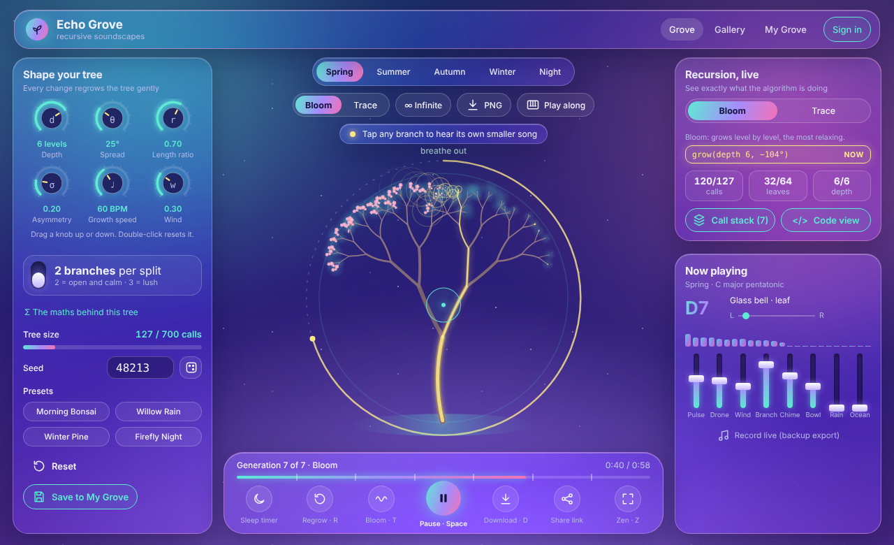

# Echo Grove

**Plant a seed, and a recursive tree grows into a calm soundscape.**
Every recursive call grows one branch and plays one note. Every base case opens a blossom and rings a chime.
The shape of the call tree becomes the shape of the song.

Built solo in 24 hours for **Hub's Quest: Epoch 1 — Recursive Soundscapes** (UIU Developers Hub, 25–26 November 2026).

**Live demo:** https://faiyajjarif.github.io/echo-grove/ (best in Chrome or Edge, with headphones)
**Sample export:** [`samples/echo-grove-spring-48213.wav`](samples/echo-grove-spring-48213.wav)
**Demo video:** _link added at submission_



## How the recursion becomes music

The recursive function runs once and writes a **score** (a timed list of `call`, `leaf` and `return` events).
Live playback, the canvas and the WAV export all read the same score, so they can never disagree,
and the same settings plus the same seed always give the same tree and the same song.

```js
function grow(node, depth) {
  playNote(node);                          // every call is a note
  if (depth === maxDepth) return chime();  // base case: a blossom and a chime
  for (const child of split(node))         // 2 or 3 children
    grow(child, depth + 1);                // every branch is a smaller copy of the tree
  resolve(node);                           // return: the stack pops
}
```

| Recursion property | Musical result |
| --- | --- |
| Depth | Octave: the trunk is low, deeper branches climb |
| Child index | Harmony: each child moves +2 / +4 scale steps, so every split forms a chord with its parent |
| Branch angle | Stereo position: `pan = cos(angle)`; left branches sound on the left |
| Branch length | Note length and loudness |
| Depth (again) | Instrument: warm pad (trunk), kalimba (branches), glass bell (leaves) |
| Base case | A chime, plus a blossom on the tree |
| Top-level subtrees | Chord progression: each subtree of the trunk takes the next chord |
| Generation | The felt-piano pulse changes its arpeggio pattern as the tree grows |
| Total calls | Length of the piece: `calls = Σ bᵏ`, capped at 700 so it never overloads |

Every pitch is snapped to the season's scale (pentatonic, Lydian, Dorian, minor pentatonic or Yo), so a wrong note is impossible.

## Features

- **Two listening modes:** *Bloom* plays the tree generation by generation (most relaxing); *Trace* plays the true depth-first call order, so you hear the call stack dive and return.
- **Recursion, live:** the current call, counters, a full call-stack pop-up and a code view that highlights the running line of pseudocode.
- **Tap any branch** to hear only its subtree: a smaller version of the whole song.
- **Synth-style controls:** rotary knobs (depth *d*, spread *θ*, ratio *r*, asymmetry *σ*, tempo ♩, wind *w*), a 2/3-branch lever, a live maths readout, seeds and four presets.
- **Five seasons:** scale, chords, instruments and colours change together.
- **Calm layers with a mixer:** pulse, drone, wind (with gusts), branches, chimes, singing bowls, rain and ocean, on vertical faders.
- **Play along:** a keyboard with 7 calm instruments, locked to the season's scale. A rule-based *harmony guide* lights up the keys that fit the chord playing right now.
- **Relaxation tools:** breathing ring (6 breaths a minute), Zen mode, Infinite Garden (new related trees forever), sleep timer with fade-out.
- **Export:** WAV (rendered offline, faster than real time), live recording backup, PNG of the tree, share links.
- **Accounts (optional):** sign in to save gardens, share them by code and publish them to the gallery; an admin can moderate. Everything musical works as a guest.

## Accessibility

Full keyboard control (Space play/pause · R regrow · T mode · I infinite · P picture · Z zen · D download · Esc close),
labelled knobs and faders (`role="slider"` with spoken values), screen-reader announcements of progress, visible focus,
`prefers-reduced-motion` support (no sway, petals or drifting background), and a mobile layout with bottom sheets.

## Tech

| Part | Stack |
| --- | --- |
| Frontend (`frontend/`) | React 18, Vite, Tone.js (all sounds synthesised, no samples), Canvas 2D |
| Backend (`backend/`) | Spring Boot 3.4 (Java 17), Spring Security + JWT, JPA, PostgreSQL in Docker |
| Tests | MockMvc integration tests (H2 in memory) |
| Deploy | GitHub Pages via GitHub Actions (frontend) |

Security basics: BCrypt passwords with a strength rule, 1-hour JWTs, USER/ADMIN roles, lockout after 5 failed logins,
per-IP rate limits, a 16 KB request cap, validated inputs with parameterised queries only, a CORS allow-list and no stack traces in errors.
Details in [`backend/README.md`](backend/README.md).

## Run locally

**Frontend only (guest mode, everything musical works):**

```bash
cd frontend
npm install
npm run dev          # http://localhost:5173
```

**With the backend (accounts, saving, gallery):** needs Docker Desktop.

```bash
cd backend
cp .env.example .env     # set admin email/password, JWT secret, DB password
mvn spring-boot:run      # starts PostgreSQL (port 5444) and the API (port 8085)

cd ../frontend
echo "VITE_API_URL=http://localhost:8085" > .env.development
npm run dev
```

## Repository layout

| Folder | Contents |
| --- | --- |
| `frontend/src/recursion/` | `grow()` and the seeded random generator |
| `frontend/src/music/` | Seasons, `compose()` (call tree → score), harmony guide |
| `frontend/src/audio/` | Tone.js engine, offline WAV export |
| `frontend/src/visual/` | Canvas renderer |
| `backend/` | Spring Boot API |
| `ai-logs/` | Complete AI prompt chain and responses |
| `docs/` | Design and plan |
| `samples/` | An exported WAV |

## AI usage

This project was built with an AI assistant (Claude, on claude.ai), as the Hub's Quest rules allow.
Every prompt and every response is logged, unedited, in [`ai-logs/`](ai-logs/README.md), with the full chat also exported as a PDF in `ai-logs/raw/`.

## Credits

Built by **Faiyaj Jarif** (GitHub [@faiyajjarif](https://github.com/faiyajjarif)).
Libraries: React, React Router, Vite, Tone.js, Spring Boot, jjwt. Fonts: Inter, Space Grotesk and JetBrains Mono (Google Fonts, OFL).
No third-party audio samples are used: every sound is synthesised in the browser.
